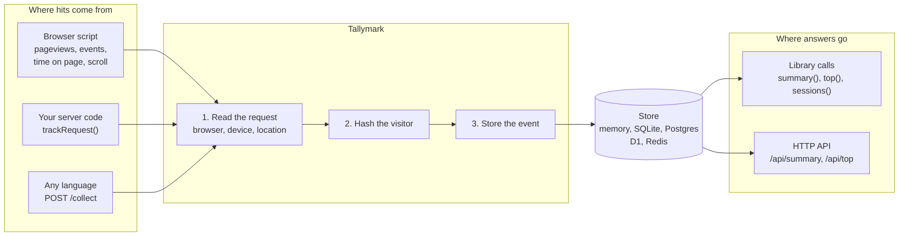
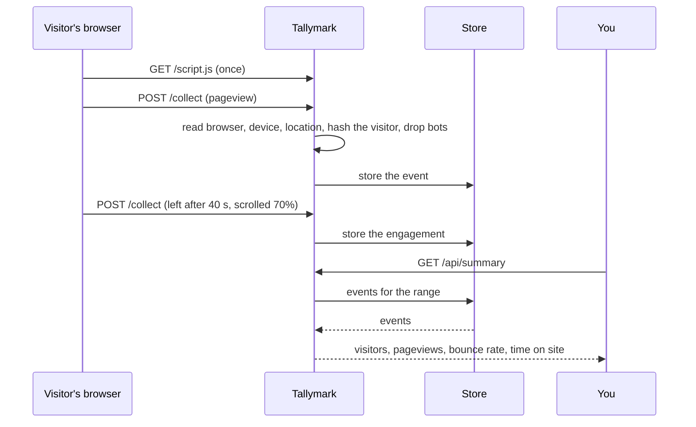

<div align="center">

<picture>
  <source media="(prefers-color-scheme: dark)" srcset="./assets/logo-dark.svg">
  
</picture>

**Count your visitors, not your visitors' data.**
<!-- 
A cookie banner means the analytics follows people.<br>
Tallymark is a library that counts the visit and forgets the person.<br>
At midnight UTC the same person becomes a different hash, so nobody can follow them into tomorrow.

It is not a dashboard, not a hosted service, and not a record of who someone is. -->

<br>

[](https://github.com/whoisjayd/tallymark/actions/workflows/ci.yml)
[](./LICENSE)
[](https://www.typescriptlang.org/)
[](./package.json)

<br>

[Quick start](#quick-start) · [Why a library](#why-a-library) · [How it works](#how-it-works) · [Reports](#what-you-can-ask) · [Storage](#storage) · [Docs](#documentation)

<br>


</div>

<br>

## Quick start

```bash
bun add tallymark        # or: npm i tallymark · pnpm add tallymark
```

The same engine runs three ways.

### A script tag

```bash
TALLYMARK_SECRET=$(openssl rand -hex 32) TALLYMARK_API_KEY=$(openssl rand -hex 24) bunx tallymark
```

```html
<script defer src="http://localhost:3000/script.js" data-localhost="true"></script>
```

```bash
curl -H "Authorization: Bearer $TALLYMARK_API_KEY" "http://localhost:3000/api/summary?range=24h"
```

The same server is a Cloudflare Worker or a Vercel function. See [Deploy](./docs/DEPLOYMENT.md).

### Your own code

No server and no database. `trackRequest()` reads the IP, browser, language and location from the request.

```ts
import { createTallymark } from 'tallymark'

const tm = createTallymark({ secret: process.env.SECRET })

await tm.trackRequest(request, { name: 'Signup', props: { plan: 'pro' }, value: 49 })

await tm.summary('7d')
await tm.top('country', '7d')
await tm.top('channel', '7d')
await tm.sessions('24h')
```

### Any language

`POST /collect` and `GET /api/summary` are plain HTTP. Python, Go, PHP, Ruby, Java and curl are in [examples/http](./examples/http). Next.js, Vercel, Express, Hono, SvelteKit, Astro, Cloudflare Workers, Bun, Deno and React are in [examples/frameworks](./examples/frameworks).

## Why a library

Plausible and Fathom you rent. Umami and Plausible CE you deploy. This one is a dependency of the app you already have, it uses the database you already run, and the answers are typed values. See [limits](./docs/HOW_IT_WORKS.md#limits).

## How it works



One visit, step by step:



Three ideas are enough to use it:

- **An event** is one thing that happened: a pageview, or a name you choose (`Signup`, `Purchase`). It records the page, where the visitor came from, their browser and device, a coarse location, and any properties or value you attach.
- **A visitor** is `hash(secret + today's date + site + IP + User-Agent)`. The raw IP and User-Agent are not stored.
- **A session** is one visit: a visitor's events, split when they go quiet for 30 minutes. A long read stays in that visit, because the engagement beacon counts as activity on the page it belongs to. Sessions are rebuilt when you ask a question, which is how bounce rate, time on site, entry and exit pages, and the path each visitor took are computed with no extra storage.

### What is automatic, and what you write

| What gets recorded | What you write |
|---|---|
| Pageviews, including single-page-app navigation | Nothing. One `<script>` tag (or `<Analytics />`) does it. |
| Referrer, UTM campaign, and channel (Direct, Search, Social, Email, Paid) | Nothing |
| Browser and version, OS, device, language, screen size | Nothing |
| Country, region, city and timezone | Nothing, on Cloudflare or Vercel (read from their headers) |
| Time on page and scroll depth | Nothing |
| Clicks on outbound links and file downloads | `data-outbound` or `data-downloads` on the script tag. Stored as `outbound` and `download`. |
| Bots, Do-Not-Track, prefetches and your own IPs are skipped | Nothing |

## Custom events

Four ways to name one. A [runnable example of each](./examples/events) is in the repo.

```html
<!-- 1. An attribute, no JavaScript. Properties are data-tally-<name>. -->
<button data-tally="Signup" data-tally-plan="pro">Start free trial</button>

<!-- 2. From JavaScript: name, properties, and a value to add up (revenue). -->
<button onclick="tallymark.track('Purchase', { sku: 'A1' }, 49)">Buy</button>
```

```ts
// 3. From your server, for things the browser cannot see (a payment webhook, an API call).
await tm.trackRequest(request, { name: 'Subscribe', props: { plan: 'free' }, value: 5 })

// 4. In React, anywhere:  import { track } from 'tallymark/react'
track('Purchase', { sku: 'A1' }, 49)
```

## What you can ask

Every question takes a time range (`'24h'`, `'7d'`, `'30d'`, … or `{ from, to }`) and optional filters on any dimension.

| Question | Call |
|---|---|
| Totals: visitors, pageviews, sessions, bounce rate, time on site and page, revenue | `summary()` |
| Is it up or down compared to the last period? | `compare()` |
| Traffic over time, by hour, day, week or month | `timeseries()` |
| The top values of anything, with time on page and scroll depth for pages | `top(dimension)` |
| Where visitors drop off | `funnel([...steps])` |
| The path each visitor took, step by step | `sessions()` |
| The most common routes through the site | `journeys()` |
| Who is on the site right now | `realtime()` |
| Every event, for export | `events()`, `export()` |

**Dimensions** for `top()` and for filters: `path` `entry_page` `exit_page` `referrer` `source` `channel` `country` `continent` `region` `city` `timezone` `language` `browser` `browser_version` `os` `os_version` `device` `screen` `utm_source` `utm_medium` `utm_campaign` `utm_term` `utm_content` `event` `hostname` `weekday` `hour`, and `prop:<name>` for any custom property, such as `prop:plan`.

The HTTP paths are in the [reference](./docs/USAGE.md).

## Storage

Events go to a *store*. Memory is the default. Every store passes the same test suite, and the PostgreSQL and Redis ones are tested against real servers.

| Store | Use it for |
|---|---|
| `memoryStore()` | Trying it out, tests. Lost on restart. |
| `bunSqliteStore(db)` | One server, a file on disk |
| `pgStore(client)` | PostgreSQL: `pg`, Neon, Supabase, Vercel Postgres, RDS |
| `d1Store(env.DB)` | Cloudflare Workers |
| `libsqlStore(client)` | Turso |
| `upstashRestStore({ url, token })` | Upstash Redis over `fetch`, for any edge runtime |
| `mirrorStore(primary, [backups])` | A live backup, or moving between stores |
| your own | Three methods: `insert`, `list`, `prune` |

Back up and restore with `export()` / `import()` (or `/api/export.ndjson`), between any two stores. Send every event to a third party with `forward: webhookSink({ url, secret })`.

## Documentation

> **Using an AI coding agent?** Point it at [llms.txt](./llms.txt). It has copy-exact integration steps for every supported platform, the rules to follow, a verification checklist and a troubleshooting table. After `npm i tallymark` it is also at `node_modules/tallymark/llms.txt`.

- **[How it works](./docs/HOW_IT_WORKS.md)**: the event model, the visitor hash, sessions, attribution, time on page, privacy, and honest limits.
- **[Reference](./docs/USAGE.md)**: every option, method, dimension, endpoint and tracker setting.
- **[Deployment](./docs/DEPLOYMENT.md)**: Cloudflare, Vercel, Docker, reverse proxies, retention and backups.
- **[Examples](./examples/README.md)**: runnable, commented, and checked.

## The name

A tally mark is the oldest way of counting: four upright strokes, and a fifth across them. That is the logo.

## Develop

```bash
bun install         # dependencies and git hooks
bun run check       # format, lint, typecheck, tests
bun run services    # real Postgres and Redis in Docker, for the store tests
bun run build && bun run smoke && bun run validate
```

ESM only. [AGENTS.md](./AGENTS.md) describes the code and its rules; [CONTRIBUTING.md](./CONTRIBUTING.md) says how to send a patch; the [Code of Conduct](./CODE_OF_CONDUCT.md) covers how people are treated here; report vulnerabilities as described in [SECURITY.md](./SECURITY.md).

## License

[AGPL-3.0-only](./LICENSE). You may use, modify and self-host it freely. If you offer a modified version to others over a network, you must share your changes under the same license.
