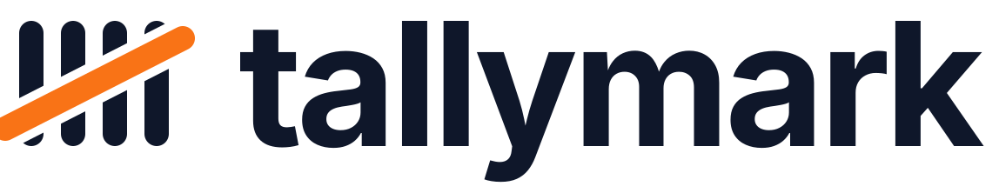
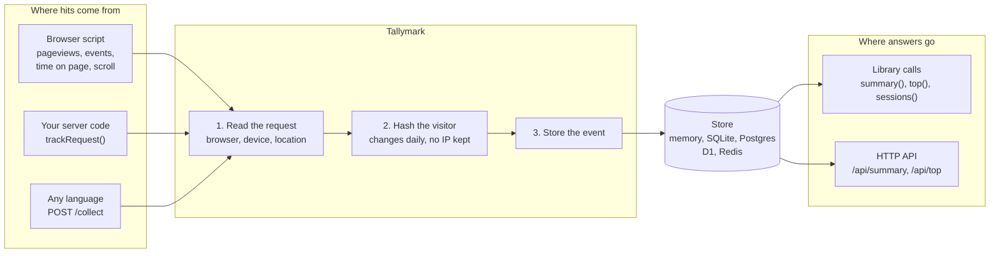
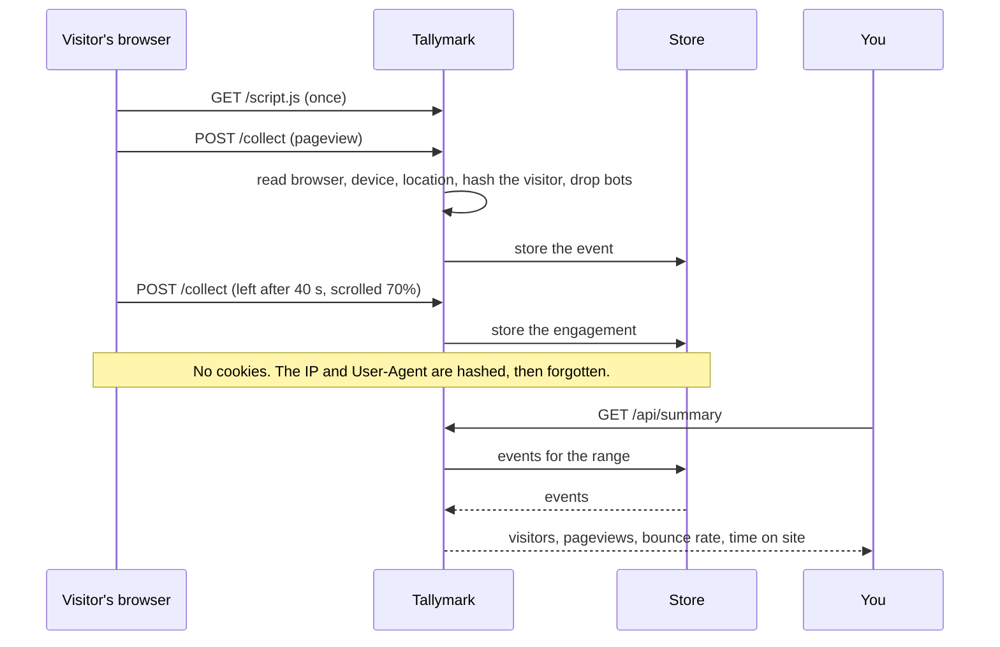

<div align="center">

<picture>
  <source media="(prefers-color-scheme: dark)" srcset="./assets/logo-dark.svg">
  
</picture>

**Count your visitors, not your visitors' data.**

[Quick start](#quick-start) · [How it works](#how-it-works) · [Custom events](#custom-events) · [Reports](#what-you-can-ask) · [Deploy](./docs/DEPLOYMENT.md) · [Reference](./docs/USAGE.md) · [Examples](./examples/README.md)

</div>

Tallymark is a small TypeScript library that tells you how many people visit your website or app, where they came from, what they looked at, and what they did. It uses no cookies and keeps nothing that identifies a person: a visitor is a hash that changes every day.

You can use it three ways, and they all share one engine:

- **As a script tag.** Add one line to your site and run the server (`bunx tallymark`, a Cloudflare Worker, a Vercel function).
- **As a library.** Call `track()` from your own code and read answers back as typed objects. No server and no database are required.
- **As an HTTP API.** Send hits and read reports from any language with `curl`.

## Why

Google Analytics tracks people across the web and needs a consent banner. Hosted privacy-friendly tools (Plausible, Fathom) are a service you pay for and cannot embed. Self-hosted ones (Umami, Plausible CE) are applications: a dashboard, a database, a deployment.

Tallymark is a **library** that does the counting. Embed it in the app you already have, put it behind your existing database, and build whatever interface you want on top of typed data. It also ships the pieces to run it standalone, so it is not either/or.

It is not a dashboard (there is no UI), not a way to follow a person across days (that is the point), and not a data warehouse (reports are computed from stored events in memory; see [limits](./docs/HOW_IT_WORKS.md#limits)).

## How it works

Hits come in from three places, Tallymark cleans and stores them, and you ask questions through the library or the HTTP API.



One visit, step by step:



Three ideas are enough to use it:

- **An event** is one thing that happened: a pageview, or a custom event you name (`Signup`, `Purchase`). It records the page, where the visitor came from, their browser and device, a coarse location, and any properties or value you attach. It never contains an IP address or a raw User-Agent.
- **A visitor** is `hash(secret + today's date + site + IP + User-Agent)`. It lets Tallymark count unique people without storing who they are. Tomorrow the same person gets a different hash, so nobody (including you) can follow them across days.
- **A session** is one visit: a visitor's events, split when they go quiet for 30 minutes. A long read stays in that visit, because the engagement beacon counts as activity on the page it belongs to. Sessions are rebuilt when you ask a question, which is how bounce rate, time on site, entry and exit pages, and the path each visitor took are computed with no extra storage.

### What is automatic, and what you write

| What gets recorded | What you write |
|---|---|
| Pageviews, including single-page-app navigation | Nothing. One `<script>` tag (or `<Analytics />`) does it. |
| Referrer, UTM campaign, and channel (Direct, Search, Social, Email, Paid) | Nothing |
| Browser and version, OS, device, language, screen size | Nothing |
| Country, region, city and timezone | Nothing, on Cloudflare or Vercel (read from their headers) |
| Time on page and scroll depth | Nothing |
| Clicks on outbound links and file downloads | One attribute on the script tag |
| **Custom events** (`Signup`, `Purchase`) | An attribute, or one `track()` call, per event |
| Bots, Do-Not-Track, prefetches and your own IPs are skipped | Nothing |

## Quick start

```bash
bun add tallymark        # or: npm i tallymark · pnpm add tallymark
```

**Run it and add one line to your site** (the fastest way to see numbers):

```bash
TALLYMARK_SECRET=$(openssl rand -hex 32) TALLYMARK_API_KEY=$(openssl rand -hex 24) bunx tallymark
```

```html
<script defer src="http://localhost:3000/script.js" data-localhost="true"></script>
```

```bash
curl -H "Authorization: Bearer $TALLYMARK_API_KEY" "http://localhost:3000/api/summary?range=24h"
```

**Or use it as a library**, with no server and no database:

```ts
import { createTallymark } from 'tallymark'

const tm = createTallymark({ secret: process.env.SECRET })

// In any route that receives a visitor's request. Their IP, browser, language and location
// are read from the request for you.
await tm.trackRequest(request, { name: 'Signup', props: { plan: 'pro' }, value: 49 })

await tm.summary('7d')              // visitors, pageviews, bounce rate, time on site, revenue
await tm.top('country', '7d')       // where they are
await tm.top('channel', '7d')       // how they found you
await tm.sessions('24h')            // the pages each visitor went through, in order
```

Using a framework? There are complete, tested examples for Next.js, Vercel, Express, Hono, SvelteKit, Astro, Cloudflare Workers, Bun, Deno and React in [examples/frameworks](./examples/frameworks), and for Python, Go, PHP, Ruby, Java and curl in [examples/http](./examples/http).

## Custom events

Pageviews and everything in the table above are automatic. An event is for what only you know matters. There are four ways to add one, and a [runnable example of each](./examples/events):

```html
<!-- 1. An attribute, no JavaScript. Properties are data-tally-<name>. -->
<button data-tally="Signup" data-tally-plan="pro">Start free trial</button>

<!-- 2. From JavaScript: name, properties, and a value to add up (revenue). -->
<button onclick="tallymark.track('Purchase', { sku: 'A1' }, 49)">Buy</button>
```

```ts
// 3. From your server, for things the browser cannot see (a payment webhook, an API call).
await tm.trackRequest(request, { name: 'Subscribe', props: { plan: 'free' }, value: 5 })

// 4. In React, anywhere:  import { track } from 'tallymark/react'
track('Purchase', { sku: 'A1' }, 49)
```

Links to other sites and file downloads are recorded as `outbound` and `download` events when you add `data-outbound="true"` or `data-downloads="true"` to the script tag.

## What you can ask

Every question takes a time range (`'24h'`, `'7d'`, `'30d'`, … or `{ from, to }`) and optional filters on any dimension.

| Question | Call |
|---|---|
| Totals: visitors, pageviews, sessions, bounce rate, time on site and page, revenue | `summary()` |
| Is it up or down compared to the last period? | `compare()` |
| Traffic over time, by hour, day, week or month | `timeseries()` |
| The top values of anything, with time on page and scroll depth for pages | `top(dimension)` |
| Where visitors drop off | `funnel([...steps])` |
| The path each visitor took, step by step | `sessions()` |
| The most common routes through the site | `journeys()` |
| Who is on the site right now | `realtime()` |
| Every event, for export | `events()`, `export()` |

**Dimensions** for `top()` and for filters: `path` `entry_page` `exit_page` `referrer` `source` `channel` `country` `continent` `region` `city` `timezone` `language` `browser` `browser_version` `os` `os_version` `device` `screen` `utm_source` `utm_medium` `utm_campaign` `utm_term` `utm_content` `event` `hostname` `weekday` `hour`, and `prop:<name>` for any custom property, such as `prop:plan`.

The same questions are available over HTTP: `GET /api/summary`, `/api/top?by=channel`, `/api/sessions`, and so on. See the [reference](./docs/USAGE.md).

## Storage

Events go to a *store*. The default is memory, so nothing is needed to start. Every store passes the same test suite, and the PostgreSQL and Redis ones are tested against real servers.

| Store | Use it for |
|---|---|
| `memoryStore()` | Trying it out, tests. Lost on restart. |
| `bunSqliteStore(db)` | One server, a file on disk |
| `pgStore(client)` | PostgreSQL: `pg`, Neon, Supabase, Vercel Postgres, RDS |
| `d1Store(env.DB)` | Cloudflare Workers |
| `libsqlStore(client)` | Turso |
| `upstashRestStore({ url, token })` | Upstash Redis over `fetch`, for any edge runtime |
| `mirrorStore(primary, [backups])` | A live backup, or moving between stores |
| your own | Three methods: `insert`, `list`, `prune` |

Back up and restore with `export()` / `import()` (or `/api/export.ndjson`), between any two stores. Send every event to a third party with `forward: webhookSink({ url, secret })`.

## Documentation

> **Using an AI coding agent?** Point it at [llms.txt](./llms.txt). It has copy-exact integration steps for every supported platform, the rules to follow, a verification checklist and a troubleshooting table. After `npm i tallymark` it is also at `node_modules/tallymark/llms.txt`.

- **[How it works](./docs/HOW_IT_WORKS.md)**: the event model, the visitor hash, sessions, attribution, time on page, privacy, and honest limits.
- **[Reference](./docs/USAGE.md)**: every option, method, dimension, endpoint and tracker setting.
- **[Deployment](./docs/DEPLOYMENT.md)**: Cloudflare, Vercel, Docker, reverse proxies, retention and backups.
- **[Examples](./examples/README.md)**: runnable, commented, and checked.

## Why "tallymark"?

A tally mark is the oldest way of counting: one stroke per thing, four upright and the fifth across them. It records that something happened and nothing about who it was. That is the whole idea of this library. (It is also why the logo looks the way it does.)

## Develop

```bash
bun install         # dependencies and git hooks
bun run check       # format, lint, typecheck, tests
bun run services    # real Postgres and Redis in Docker, for the store tests
bun run build && bun run smoke && bun run validate
```

ESM only. [AGENTS.md](./AGENTS.md) describes the code and its rules; [CONTRIBUTING.md](./CONTRIBUTING.md) says how to send a patch; the [Code of Conduct](./CODE_OF_CONDUCT.md) covers how people are treated here; report vulnerabilities as described in [SECURITY.md](./SECURITY.md).

## License

[AGPL-3.0-only](./LICENSE). You may use, modify and self-host it freely. If you offer a modified version to others over a network, you must share your changes under the same license.
